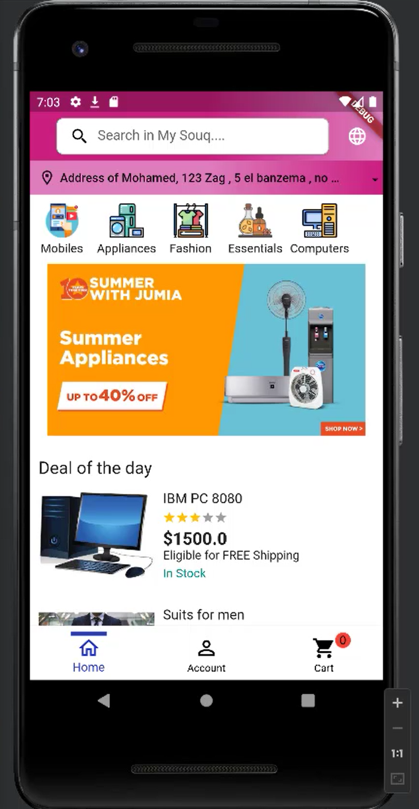
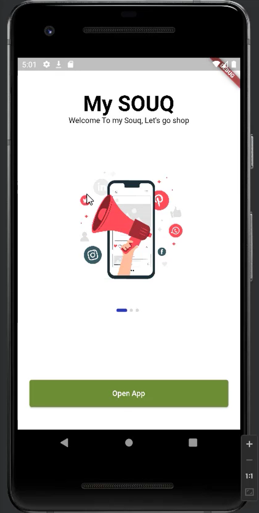
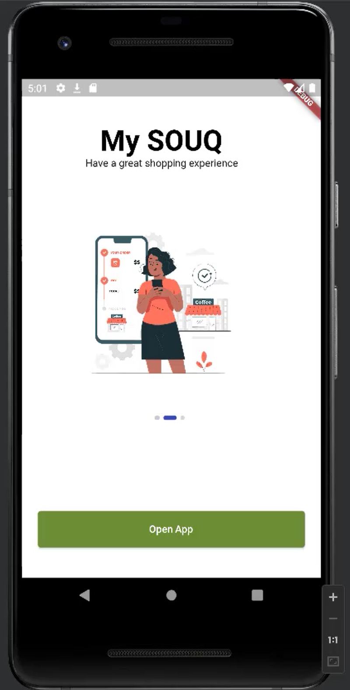
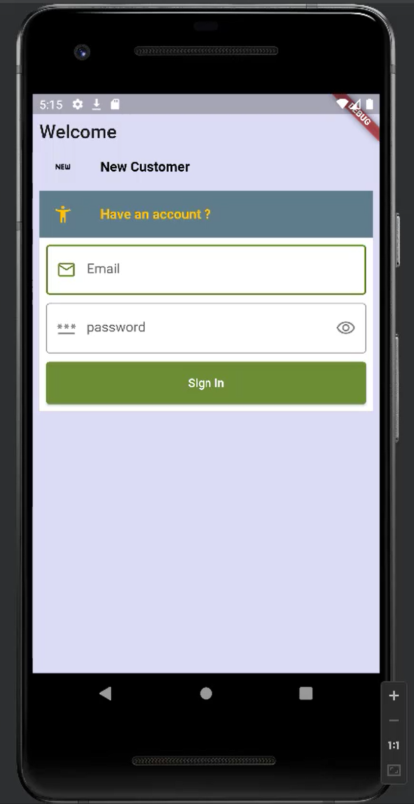
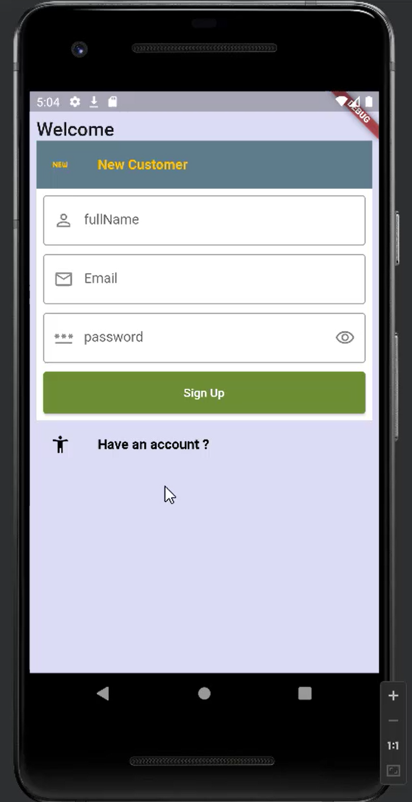
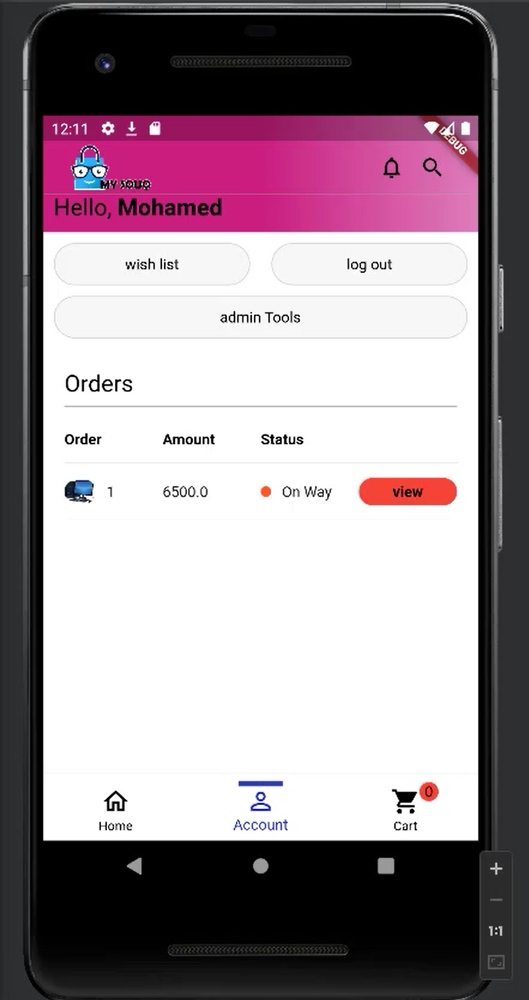
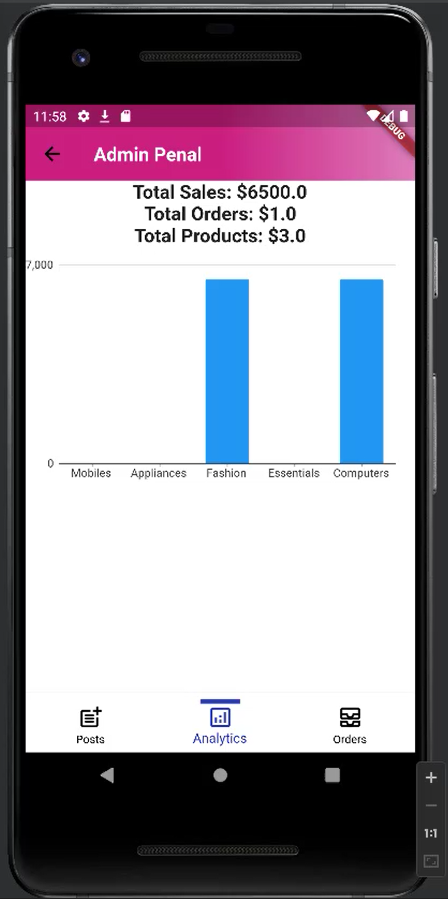

# My Souq — by Ahmed Mohamady

**Created and maintained by Ahmed Mohamady**  
Software Developer · Technical Educator · Chief Development Officer at Congineer Business Solutions

[YouTube](https://www.youtube.com/@ahmedmohamady) · [LinkedIn](https://www.linkedin.com/in/almohamady/) · [Facebook](https://www.facebook.com/AlMohamady86) · [X](https://x.com/alMohamady86)

## About Ahmed Mohamady

I'm Ahmed Mohamady, a software developer and technical educator, and the Chief Development Officer at Congineer Business Solutions. My work spans business applications, Odoo development and integrations, .NET, and mobile applications.

I share practical programming knowledge in Arabic through my YouTube channel and online courses, helping developers connect technical concepts with real projects.

My Souq is part of that knowledge-sharing journey. By sharing the source code, I want to make my development approach accessible, give developers a practical project to explore, and create opportunities to learn and improve it together.

**Explore the code, contribute your ideas, and join me on [YouTube](https://www.youtube.com/@ahmedmohamady) for more programming content. Connect with me on [LinkedIn](https://www.linkedin.com/in/almohamady/) for professional updates and collaboration.**

## About My Souq

### Flutter shopping app connected to a separate Node.js backend

My Souq is an e-commerce application inspired by familiar marketplace shopping experiences such as Amazon. This repository contains the Flutter mobile client, with Arabic and English interfaces. It connects to a Node.js backend maintained in a separate repository.

The project is being prepared for an open-source release to share practical knowledge, support community learning, and invite contributions.

## Features

The supplied Flutter source includes client-side implementations for:

- Onboarding, account registration, sign-in, token validation, and logout.
- Arabic and English localization with RTL layout support.
- Product browsing by category, search, and deal of the day.
- Product details and ratings.
- Cart updates and subtotal display.
- Shipping address entry and cash-on-delivery order submission.
- Order history and order details.
- Admin product listing, creation, image upload, and deletion.
- Admin order listing and status updates.
- Admin totals for sales, orders, and products.

These flows depend on the Node.js API. Backend behavior and end-to-end operation have not been verified from the provided Flutter files alone.

### Current limitations

- The wishlist button has an empty callback.
- Google Pay UI code is commented out; Apple Pay is not implemented in the reviewed Dart source. Payment configuration assets and the `pay` dependency alone do not establish working payment support.
- The analytics chart is commented out in the current source. The historical screenshot below shows a chart from a different application state.
- Some interface text remains hardcoded in English.
- The source theme differs from the supplied screenshots, so the current appearance may vary.

## Screenshots

### Shopping

| English home | Arabic home |
| :---: | :---: |
|  |  |

### Onboarding

| Welcome | Shopping introduction |
| :---: | :---: |
|  |  |

### Authentication

| Sign in | Sign up |
| :---: | :---: |
|  |  |

### Account and administration

| Account and orders | Admin analytics |
| :---: | :---: |
|  |  |

## Technology

| Layer | Technology |
| --- | --- |
| Mobile client | Flutter / Dart |
| Backend | Node.js |
| UI languages | Arabic and English |
| Screenshot platform | Android emulator |

### Client dependencies

The following are declared constraints from `pubspec.yaml`, not resolved versions from a lockfile.

| Package | Declared constraint | Purpose |
| --- | --- | --- |
| `provider` | `^6.1.2` | User state via `ChangeNotifierProvider` |
| `http` | `^1.2.1` | HTTP API requests |
| `shared_preferences` | `^2.2.3` | Local authentication-token persistence |
| `flutter_localizations` | Flutter SDK | Localization delegates |
| `intl` | `^0.19.0` | Internationalization utilities |
| `cloudinary_public` | `^0.23.1` | Product-image uploads |
| `file_picker` | `^8.0.3` | File selection |
| `carousel_slider` | `^4.2.1` | Image carousels |
| `flutter_rating_bar` | `^4.0.1` | Rating input/display |
| `badges` | `^3.1.2` | UI badges |
| `dotted_border` | `^2.1.0` | Dotted borders |
| `flutter_speed_dial` | `^7.0.0` | Floating action menu |
| `cupertino_icons` | `^1.0.8` | Icons |
| `pay` | `^2.0.0` | Payment dependency; Google Pay UI currently disabled |

Development dependencies include Flutter's `flutter_test` and `flutter_lints: ^4.0.0`.

**Dart SDK constraint:** `>=3.4.1 <4.0.0`. This does not establish compatibility with every Flutter release in that range. A tested Flutter version and resolved dependencies still need to be recorded.

Backend dependencies, database setup, authentication internals, and server startup instructions belong in the separate backend repository.

## Client source layout

- `lib/main.dart`: application entry point, provider registration, localization, and startup authentication.
- `lib/router.dart`: named routes.
- `lib/providers/user_provider.dart`: user state.
- `lib/app/models/`: user, product, order, rating, language, and sales models.
- `lib/app/screens/`: shopping, authentication, checkout, and administration screens.
- `lib/app/services/`: authentication, catalog, product/order, and admin HTTP calls.
- `lib/app/widgets/`: reusable UI components.
- `lib/components/declarations.dart`: API base URL, theme, categories, and banner URLs.
- `lib/l10n/`: English and Arabic ARB resources.

## Getting started

### Prerequisites

- Git.
- Flutter SDK compatible with the application's `pubspec.yaml`.
- An Android emulator or a physical device configured for Flutter development.
- Access to a running compatible My Souq backend, hosted remotely or started from its separate repository.

### 1. Download the source

Clone this repository using its GitHub clone URL, then open the project directory.

### 2. Connect to the separate backend

The Node.js backend is maintained separately and is not included in this repository. Its repository link will be added when available.

To use API-dependent features, obtain access to a compatible running backend. If running it locally, follow the installation and startup instructions in the backend repository. Then configure the Flutter API URL as described below.

### 3. Run the Flutter client

Open the directory containing `pubspec.yaml`, then run:

```bash
flutter pub get
```

Configure `myUri01` in `lib/components/declarations.dart`:

```dart
String myUri01 = "http://10.0.2.2:3020";
```

This is the current development default, not proof that the backend actually listens on port 3020. Adjust the address to match your running API.

The client imports `package:flutter_gen/gen_l10n/app_localizations.dart`. Use a compatible Flutter toolchain and localization-generation configuration, or migrate these imports when upgrading. Run localization generation with the project's configuration:

```bash
flutter gen-l10n
```

The complete project must also include the assets declared in `pubspec.yaml`; the `lib` archive alone is insufficient to build the app.

Then launch:

```bash
flutter run
```

The device must be able to reach the backend. On the standard Android Emulator, `10.0.2.2` generally points to the development host; a physical device normally needs a reachable LAN address or a hosted API URL. Match the backend's actual protocol and port.

## API routes used by the client

These are the routes called in the supplied Dart service files, not verified server documentation. Authenticated calls use the `my-souq-auth-token` header.

| Method | Route | Client purpose |
| --- | --- | --- |
| POST | `/api/signup` | Register |
| POST | `/api/signin` | Sign in |
| POST | `/isValidToken` | Validate stored token |
| GET | `/` | Load current user |
| GET | `/api/get-products?category={category}` | Category products |
| GET | `/api/get-products/search/{text}` | Search |
| GET | `/api/deal-of-the-day` | Featured deal |
| POST | `/api/rate-product` | Rate a product |
| POST | `/api/add-to-cart` | Add to cart |
| DELETE | `/api/remove-to-cart/{productId}` | Remove/decrease cart item |
| POST | `/api/save-user-address` | Save address |
| POST | `/api/order` | Submit order |
| GET | `/api/my-orders` | Customer orders |
| POST | `/admin/add-product` | Create product |
| GET | `/admin/get-products` | Admin product list |
| POST | `/admin/delete-products` | Delete product |
| GET | `/api/all-orders-admin` | Admin order list |
| POST | `/admin/update-order-status` | Update order status |
| GET | `/admin/analytics` | Admin totals |

## Cloudinary configuration

Product-image uploads are configured in `lib/app/services/admin_service.dart` through `CloudinaryPublic`. Replace the existing cloud name and upload preset with your own configuration. Cloud names and unsigned preset names are client-visible identifiers; never put a Cloudinary API secret in the mobile app. Review upload restrictions before exposing an unsigned preset publicly.

## Configuration and security

- Keep real credentials, tokens, signing keys, and private configuration out of Git.
- Provide example configuration with dummy values and document each required setting.
- Use synthetic demo accounts, addresses, products, and orders.
- Enforce authentication and admin authorization on the backend.
- Never put a backend secret into the mobile client.
- The current client stores its authentication token in `SharedPreferences`; review token storage and session handling before production deployment.
- Checkout address validation currently displays an error but can continue into address-saving and order-submission calls. Fix this control flow before relying on validation.
- The backend must independently validate prices, quantities, stock, addresses, payment state, and admin permissions.

## Contributing

Contributions are welcome as the public release is prepared.

1. Open an issue describing the bug or proposed improvement.
2. Fork the repository and create a focused branch.
3. Follow the existing project conventions.
4. Verify the affected behavior and include screenshots for UI changes.
5. Submit a pull request explaining what changed and how it was checked.

Please discuss substantial changes in an issue before implementing them.

## Release preparation

- [ ] Confirm clean installation and startup from a fresh clone.
- [ ] Replace the setup notes above with exact, verified commands.
- [ ] Document the tested Flutter version and add the separate backend repository link.
- [ ] Verify each client workflow against the running backend and resolve the limitations above.
- [ ] Add example configuration and safe demo data.
- [ ] Review dependency and third-party asset licenses.
- [ ] Replace unlicensed promotional artwork and remove personal data.
- [ ] Choose an open-source license and add its full text in a root `LICENSE` file.
- [ ] Add contribution guidelines and a private security-reporting route.

## License

An open-source license has not been specified in this documentation package. Before releasing the application as open source, the maintainer must choose an appropriate license, include its full text in `LICENSE`, and update this section.

Third-party libraries, trademarks, product images, banners, and illustrations may have separate terms. A source-code license does not automatically cover those assets.

## Acknowledgments

Inspired by common e-commerce marketplace workflows. This project is independent and is not affiliated with or endorsed by Amazon, Jumia, or other brands appearing in the demo screenshots.

## Stay connected

Created and maintained by **Ahmed Mohamady**.

- [YouTube — programming tutorials and practical projects](https://www.youtube.com/@ahmedmohamady)
- [LinkedIn — professional updates and collaboration](https://www.linkedin.com/in/almohamady/)
- [Facebook](https://www.facebook.com/AlMohamady86)
- [X](https://x.com/alMohamady86)

If you find this project useful, consider giving it a star and sharing it with other developers.
